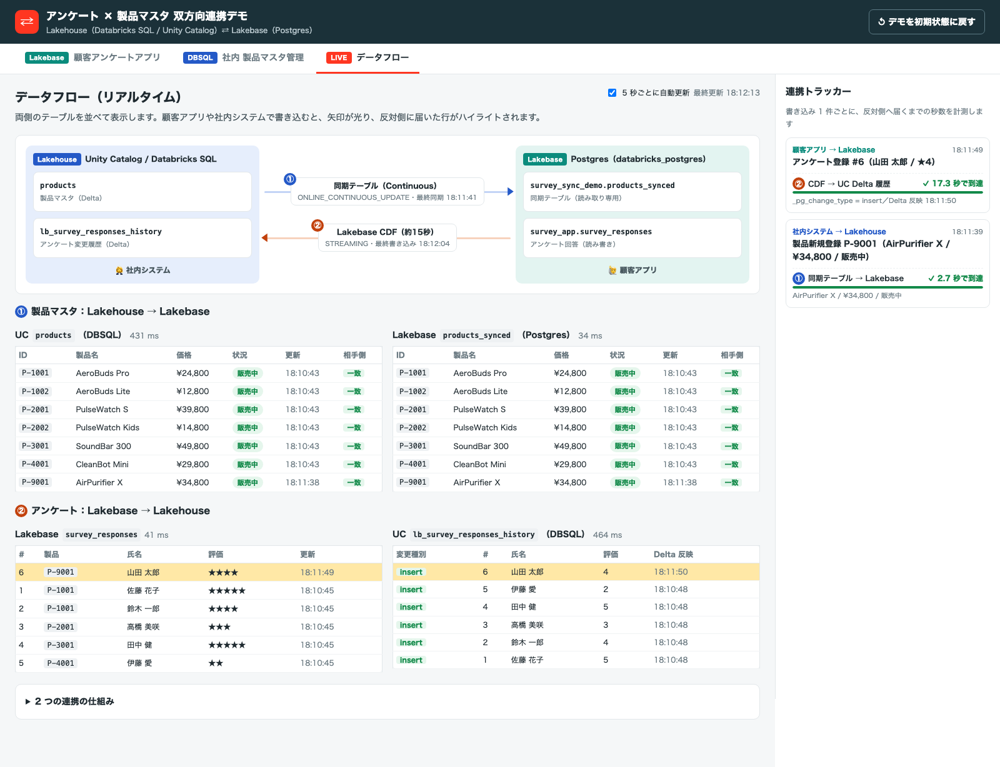
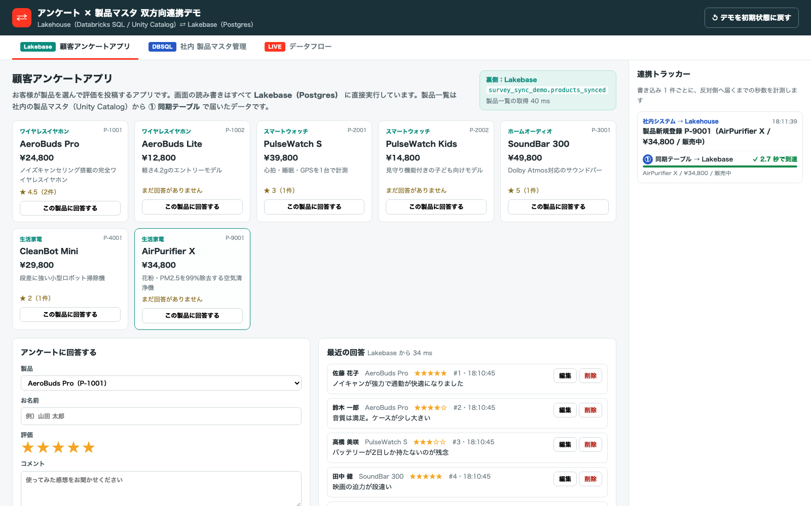
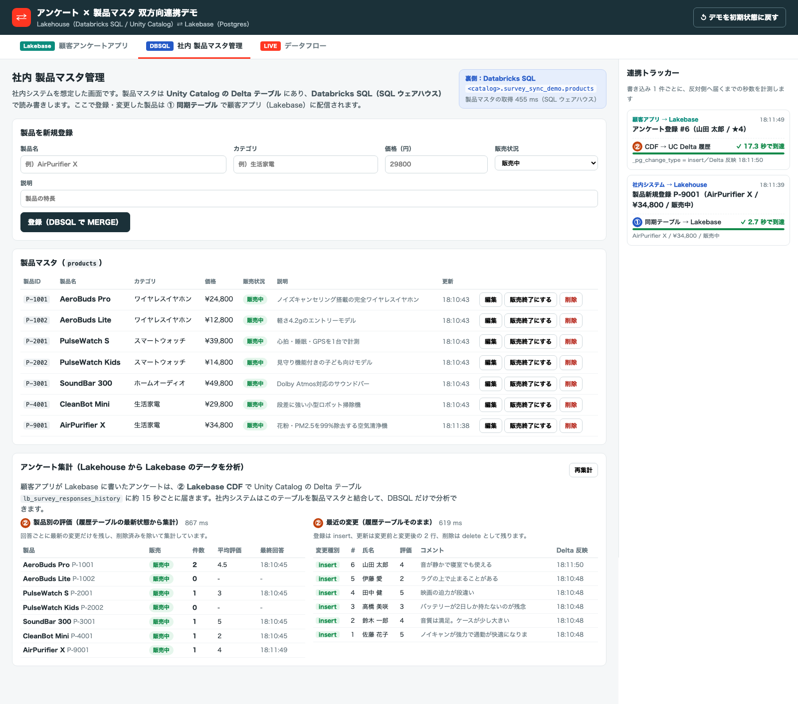
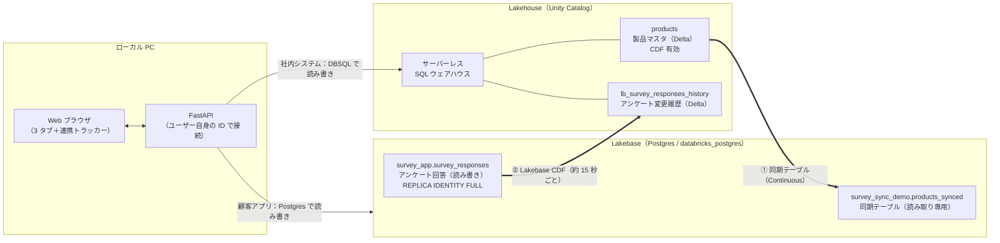
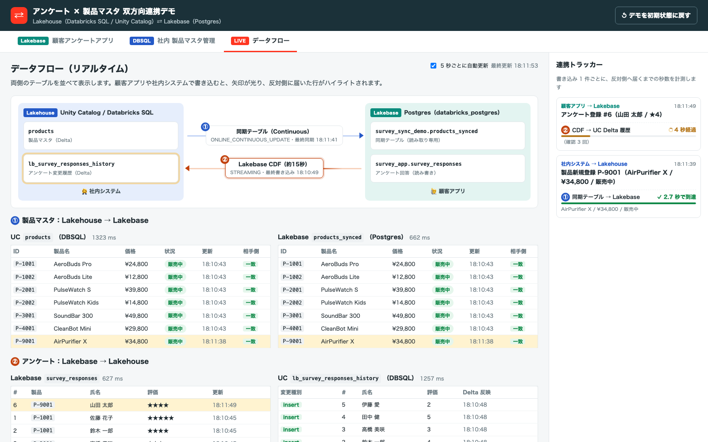
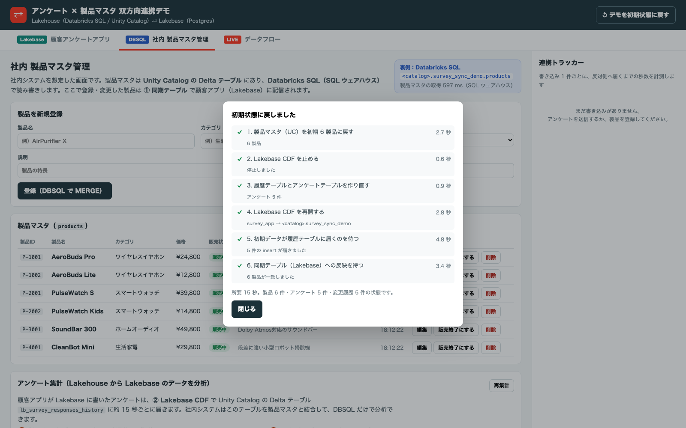

# Lakehouse × Lakebase 双方向連携デモ（アンケート × 製品マスタ）

ローカル PC で動く Web アプリから **Lakehouse（Databricks SQL）** と **Lakebase（Postgres）** の両方に読み書きし、
**同期テーブル** と **Lakebase CDF** でデータが反対側に届くまでを、実データと秒数で確認するデモです。

- 顧客向けアプリ（アンケート）は Lakebase に直接読み書きする
- 社内システム（製品マスタ）は Unity Catalog の Delta テーブルを Databricks SQL で読み書きする
- 製品マスタは **同期テーブル** で Lakebase へ、アンケートは **Lakebase CDF** で Lakehouse へ、それぞれ数秒〜十数秒で届く



---

## 目次

1. [デモの概要](#1-デモの概要)
2. [アーキテクチャ](#2-アーキテクチャ)
3. [使っている連携機能](#3-使っている連携機能)
4. [デモの事前準備](#4-デモの事前準備)
5. [デモの流れ](#5-デモの流れ)
6. [初期状態に戻す](#6-初期状態に戻す)
7. [補足（実測値・注意点・後片付け）](#7-補足)

---

## 1. デモの概要

### 想定シナリオ

家電メーカーが、お客様向けのアンケートアプリと、社内の製品マスタ管理システムを運用している想定です。

| 登場人物 | 使う画面 | 裏側のデータ | 求められること |
|---|---|---|---|
| お客様 | 顧客アンケートアプリ | Lakebase（Postgres） | 製品一覧がすぐ表示され、回答をすぐ保存できる（OLTP） |
| 社内の担当者 | 社内 製品マスタ管理 | Lakehouse（Unity Catalog / Databricks SQL） | 製品マスタを一元管理し、アンケートを分析できる（OLAP） |

**製品マスタは Lakehouse が正**、**アンケートは Lakebase が正** です。それぞれを反対側へ自動で届けることで、アプリ側にデータ連携のコードを書かずに双方向のデータの流れを作ります。

### アプリの画面

| タブ | 裏側 | できること |
|---|---|---|
| 顧客アンケートアプリ | Lakebase | 製品一覧（同期テーブルから）の表示、アンケートの登録・編集・削除 |
| 社内 製品マスタ管理 | Databricks SQL | 製品の登録・編集・販売終了・削除、CDF 履歴テーブルを使ったアンケート集計と変更履歴の表示 |
| データフロー | 両方 | 構成図と、両側のテーブルを並べた画面（5 秒ごとに自動更新） |

画面右側の **連携トラッカー** は全タブ共通です。書き込み 1 件ごとに、反対側のテーブルをポーリングし、**書き込みから何秒で届いたか** を表示します。

| 顧客アンケートアプリ（Lakebase） | 社内 製品マスタ管理（Databricks SQL） |
|---|---|
|  |  |

---

## 2. アーキテクチャ



### 構成要素

| 要素 | 役割 |
|---|---|
| ローカルアプリ（FastAPI＋HTML/JS） | 画面の配信と API。Databricks SDK でユーザー自身の ID（CLI の OAuth）を使って接続する |
| Databricks SQL（サーバーレス SQL ウェアハウス） | 社内システムの読み書き。Statement Execution API で `MERGE` / `SELECT` を実行する |
| Lakebase（Autoscaling、PG17） | 顧客アプリの読み書き。OAuth トークンをパスワードにして Postgres に直接接続する |
| ① 同期テーブル | 製品マスタ（Delta）を Lakebase の Postgres テーブルへ常時コピーする |
| ② Lakebase CDF | アンケートテーブルの変更を Delta の履歴テーブルへ書き出す |

### 上りと下りでテーブルを分ける理由

同じテーブルを双方向に同期すると、変更が行ったり来たりしてループします。このデモでは
**下り（Lakehouse → Lakebase）は製品マスタ、上り（Lakebase → Lakehouse）はアンケート** と、
「正」が片側にあるテーブルごとに向きを 1 つに決めています。

---

## 3. 使っている連携機能

### ① 同期テーブル（Lakehouse → Lakebase）

公式ドキュメント: https://docs.databricks.com/aws/ja/oltp/projects/sync-tables

Unity Catalog のテーブル（Delta / Iceberg / ビュー / マテリアライズドビュー）を、Lakebase の Postgres テーブルとして **コピーし続ける** 機能です。
内部ではマネージドな Lakeflow パイプラインが動き、分析用に整えたデータをアプリから低遅延で読めるようにします。

| 同期モード | 動き | 向いている用途 |
|---|---|---|
| Snapshot | 毎回すべての行をコピーし直す | 1 回あたりの変更が全体の 10% を超えるとき |
| Triggered | 手動またはスケジュールで、変更分だけ反映する | 決まった間隔で更新すればよいとき |
| **Continuous**（このデモ） | 変更をストリーミングで反映する（最短 15 秒間隔） | 低遅延が必要なとき（コストは最も高い） |

- Triggered と Continuous では、ソーステーブルの **変更データフィード（`delta.enableChangeDataFeed = true`）** が必要
- 主キーが必要。主キーが NULL の行は同期されない
- Postgres 側は **読み取り専用**（参照とインデックス作成のみ。書き込みは次回の同期で上書きされる）
- 同期先スキーマに `USE_SCHEMA` と `CREATE_TABLE` の権限が必要

### ② Lakebase CDF（Lakebase → Lakehouse）

公式ドキュメント: https://docs.databricks.com/aws/ja/oltp/projects/lakebase-cdf

Lakebase（Postgres）の変更を WAL から読み取り、Unity Catalog の Delta テーブル **`lb_<テーブル名>_history`** に **約 15 秒ごと** に書き込む機能です（パブリックプレビュー）。
Postgres の **スキーマ単位** で設定し、スキーマ内のテーブルが対象になります。外部のパイプラインやジョブは不要です。

履歴テーブルには元の列に加えて、次の列が付きます。

| 列 | 内容 |
|---|---|
| `_pg_change_type` | `insert` / `update_preimage` / `update_postimage` / `delete`（更新は変更前と変更後の 2 行になる） |
| `_pg_lsn` | Postgres のログシーケンス番号 |
| `_pg_xid` | Postgres のトランザクション ID |
| `_timestamp` | 変更を処理した時刻 |
| `_sort_by` | 並べ替え用の単調増加キー |

- 対象テーブルに **`REPLICA IDENTITY FULL`** が必要（ないテーブルは同期されない）
- 行が 1 件以上あるテーブルだけが同期される
- 書き込み先のカタログに **デフォルトストレージは使えない**（`Lakebase CDF is not supported for catalogs using Default Storage`）
- ワークスペース管理者が、プレビュー画面で「Lakebase Change Data Feed」を有効にしておく
- Lakebase プロジェクトに `CAN MANAGE`、書き込み先に `USE CATALOG` / `USE SCHEMA` / `CREATE TABLE` が必要

---

## 4. デモの事前準備

### 4-1. 前提条件

| 項目 | 条件 |
|---|---|
| ワークスペース | Lakebase（Autoscaling）が使えること |
| UC カタログ | **デフォルトストレージ以外**（ワークスペースのストレージや外部ロケーション）を管理ストレージにしたカタログ（② CDF の制約） |
| SQL ウェアハウス | サーバーレス SQL ウェアハウス |
| プレビュー | 「Lakebase Change Data Feed」が有効 |
| 権限 | 上記カタログ・スキーマへの作成権限、Lakebase プロジェクトの作成権限 |
| ローカル PC | Python 3.12、[uv](https://docs.astral.sh/uv/)、Databricks CLI（`databricks postgres` コマンドが使えるもの）、Lakebase へ TCP 5432 で接続できるネットワーク |

### 4-2. セットアップ手順（初回のみ）

```bash
git clone https://github.com/ytcy-db/lakehouse_lakebase_sync_demo.git
cd lakehouse_lakebase_sync_demo

# 1) Python 環境
uv venv .venv --python 3.12
uv pip install --python .venv/bin/python -r requirements.txt

# 2) Databricks CLI でログイン（プロファイルを作る）
databricks auth login --host https://<workspace-url> --profile <your-profile>

# 3) 接続先を設定（プロファイル名・ウェアハウス ID・カタログ名を書き換える）
cp app/.env.example app/.env

# 4) Lakebase プロジェクトを作成（production ブランチと primary エンドポイントが自動で作られる）
databricks postgres create-project survey-sync-demo \
  --json '{"spec": {"display_name": "Survey Sync Demo", "pg_version": 17}}' -p <your-profile>

# 5) テーブルと初期データ
.venv/bin/python setup/01_uc_setup.py        # UC：スキーマ survey_sync_demo と製品マスタ（6 製品、CDF 有効）
.venv/bin/python setup/02_lakebase_setup.py  # Lakebase：アンケートテーブル（5 件、REPLICA IDENTITY FULL）

# 6) 2 つの連携を作成
./setup/03_sync_setup.sh all   # ① 同期テーブル（Continuous）と ② Lakebase CDF
```

`03_sync_setup.sh` は `synced` / `cdf` を個別に指定して実行することもできます。
同期テーブルのパイプライン起動には数分かかります。データフロー画面の ① が `ONLINE_CONTINUOUS_UPDATE`、② が `STREAMING` になれば準備完了です。

### 4-3. デモ当日の直前チェック

1. アプリを起動する: `./run.sh` → http://localhost:8000
2. 画面右上の **「↺ デモを初期状態に戻す」** を押す（約 20 秒。リハーサルのデータを消す）
3. **データフロー** タブで、① が `ONLINE_CONTINUOUS_UPDATE`、② が `STREAMING` と表示されることを確認する
4. 各タブを一度開いておく（SQL ウェアハウスと Lakebase のコンピュートを起こしておく）

---

## 5. デモの流れ

所要時間は 10〜15 分が目安です。① と ② の到達秒数は、右側の連携トラッカーに表示されます。

### Step 0. 全体像を説明する（データフロー タブ）

- 左が Lakehouse（Unity Catalog）、右が Lakebase（Postgres）
- 製品マスタは ① 同期テーブルで右へ、アンケートは ② Lakebase CDF で左へ流れる
- 下の表は両側の実データで、5 秒ごとに更新される

### Step 1. 社内で新製品を登録する → 顧客アプリに出る（①）

1. **社内 製品マスタ管理** タブで、製品名・カテゴリ・価格を入れて「登録（DBSQL で MERGE）」
2. 連携トラッカーの「① 同期テーブル → Lakebase」が数秒で **到達** になる
3. **顧客アンケートアプリ** タブを開くと、新製品のカードが追加されている（背景が一瞬光る）

> 話すポイント: アプリは Lakebase しか見ていない。製品マスタの更新を Lakebase に書き込む処理は、アプリにもジョブにも書いていない。

### Step 2. 販売終了にする → 顧客アプリから消える（①）

1. 社内タブで既存の製品の「販売終了にする」を押す
2. 数秒後、顧客アプリの製品一覧からその製品が消える

### Step 3. お客様がアンケートに回答する → 社内で分析できる（②）

1. **顧客アンケートアプリ** でアンケートを送信する（Lakebase への INSERT は数十 ms）
2. 連携トラッカーの「② CDF → UC Delta 履歴」が十数秒で **到達** になる
3. **社内 製品マスタ管理** の「アンケート集計」で、その製品の件数と平均評価が増えている

> 話すポイント: 社内システムは DBSQL しか使っていない。Lakebase に書かれたデータが、Delta テーブルとして自動で届き、製品マスタと結合して分析できる。



### Step 4. 回答を編集・削除する → 変更履歴が残る（②）

1. 顧客アプリの「最近の回答」で、回答を編集（評価を変更）してから削除する
2. 社内タブの「最近の変更」に、`update_preimage` / `update_postimage` / `delete` が並ぶ

> 話すポイント: Lakebase の今の値だけでなく、いつ・何が・どう変わったかが Delta に残る。監査や時系列の分析に使える。

### Step 5. まとめ

| 向き | 機能 | このデモで見えたこと |
|---|---|---|
| Lakehouse → Lakebase | ① 同期テーブル | 社内で管理する製品マスタが、数秒で顧客アプリに出る |
| Lakebase → Lakehouse | ② Lakebase CDF | 顧客アプリの回答が、変更履歴つきで十数秒後に分析できる |

---

## 6. 初期状態に戻す

画面右上の **「↺ デモを初期状態に戻す」** ボタンで、次の処理を順に実行します（約 20 秒）。



1. 製品マスタ（UC `products`）を初期の 6 製品に戻す
2. Lakebase CDF を止める
3. 履歴テーブル（UC）とアンケートテーブル（Lakebase）を作り直す
4. Lakebase CDF を再開する
5. 初期 5 件が履歴テーブルに `insert` として届くのを待つ
6. 同期テーブル（Lakebase）が初期 6 製品と一致するのを待つ

コマンドで実行することもできます: `.venv/bin/python setup/04_reset_demo.py`

---

## 7. 補足

### ディレクトリ構成

```
.
├── app/
│   ├── main.py              # FastAPI（画面・API）
│   ├── .env.example         # 接続先の設定例（app/.env にコピーして使う）
│   ├── backend/
│   │   ├── config.py        # 接続先の設定（app/.env を読む）
│   │   ├── dbsql.py         # Databricks SQL（Statement Execution API）
│   │   ├── lakebase.py      # Lakebase（OAuth トークンで Postgres 接続、コネクションプール）
│   │   ├── tracker.py       # 連携トラッカー（到達をポーリングして秒数を計測）
│   │   ├── seed.py          # テーブル定義と初期データ
│   │   └── reset.py         # 初期状態に戻す処理
│   └── static/              # 画面（HTML / CSS / JavaScript）
├── setup/
│   ├── 01_uc_setup.py       # UC のスキーマ・製品マスタ
│   ├── 02_lakebase_setup.py # Lakebase のアンケートテーブル
│   ├── 03_sync_setup.sh     # ① 同期テーブル・② Lakebase CDF の作成
│   └── 04_reset_demo.py     # 初期状態に戻す（ボタンと同じ処理）
├── docs/images/             # README の画像
├── requirements.txt
└── run.sh                   # アプリの起動
```

### 到達時間の計測方法

書き込みのたびに `updated_at`（ミリ秒に丸めた時刻）を記録し、反対側のテーブルに同じ `updated_at` の行が現れるまでポーリングします
（同期テーブルは 1 秒間隔、CDF 履歴は 2 秒間隔）。表示する秒数は「書き込み完了から、到達を確認するまで」です。

### 実測値（AWS 東京リージョン、Lakebase 1 CU、クライアントは東京）

| 処理 | 時間 |
|---|---|
| ① 同期テーブル（登録・更新・削除） | 2.6〜6.5 秒 |
| ② Lakebase CDF（insert / update / delete） | 4〜18 秒 |
| Lakebase への書き込み | 約 40 ms |
| Databricks SQL での MERGE | 約 2〜4 秒 |
| 初期状態に戻す | 約 15〜20 秒 |

### 注意点

- 同期テーブル（`products_synced`）に Postgres から書き込まないでください。
- Continuous モードの同期テーブルは、使っていない間もパイプラインが動き続けて課金されます。使わない期間は後片付けの手順で削除してください。
- Lakebase CDF は同じスキーマで「開始」をやり直すと競合します。テーブルを追加するときは、同じスキーマにテーブルを作るだけにしてください。
- macOS で Lakebase のホスト名が名前解決できない場合は、`dig` で IP を調べ、接続パラメータの `hostaddr` に指定してください。

### 後片付け

```bash
P=<your-profile>; CAT=<catalog>
DBPATH=projects/survey-sync-demo/branches/production/databases/databricks-postgres

databricks postgres delete-cdf-config   $DBPATH/cdf-configs/survey_app_feed -p $P
databricks postgres delete-synced-table synced_tables/$CAT.survey_sync_demo.products_synced -p $P
databricks postgres delete-project      projects/survey-sync-demo -p $P
# UC のスキーマは SQL エディタで: DROP SCHEMA <catalog>.survey_sync_demo CASCADE
```

## ライセンス

[MIT License](LICENSE)
